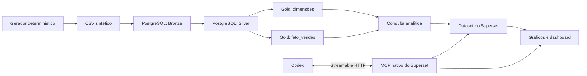

# Engenharia de dados de vendas com PostgreSQL, Superset e Codex MCP

[Repositório no GitHub](https://github.com/igorlpc21/vendas-data-engineering-superset-mcp)

[Repositório no GitHub](https://github.com/igorlpc21/vendas-data-engineering-superset-mcp)

Pipeline educacional de ponta a ponta: dados sintéticos de vendas, camadas Bronze/Silver/Gold, modelo dimensional e um dashboard executivo no Apache Superset. O Codex utiliza o MCP nativo do Superset para descobrir recursos e criar visualizações com configurações verificadas.

Este projeto foi organizado como portfólio de engenharia de dados. Os notebooks explicam as etapas; scripts e SQL permitem reproduzir a carga sem executar células manualmente.

**Status:** publicado no GitHub, com [CI aprovada](https://github.com/igorlpc21/vendas-data-engineering-superset-mcp/actions/runs/40411258044), incluindo carga inicial e reexecução em PostgreSQL descartável. O build e o boot do laboratório completo Superset/MCP ainda precisam ser verificados. O dashboard da sessão existe, mas não está incluído como export nativo importável. Veja as [limitações e evidências](docs/analise/diagnostico.md).

## O que este projeto demonstra

- Ingestão e reconciliação entre fonte e Data Warehouse.
- Transformações de qualidade, padronização e modelagem estrela.
- Definição consistente de indicadores de negócio.
- Uso de ferramentas MCP com descoberta de schemas e validação posterior.
- Separação entre cálculo correto, configuração aceita e resultado visual validado.
- Organização para revisão técnica: testes, CI, exemplos sem segredos e instruções de reprodução.

## Arquitetura



Bronze/Silver/Gold são schemas PostgreSQL neste laboratório; não há lakehouse, Spark ou armazenamento de objetos.

## Resultado de referência

Base sintética, sem dados de clientes reais. Uma linha representa uma venda com um único produto e sua quantidade.

| Indicador | Resultado de referência |
|---|---:|
| Vendas distintas | 1.000 |
| Faturamento líquido após desconto | R$ 2.318.923,25 |
| Ticket médio | R$ 2.318,92 |
| Itens vendidos | 3.074 |
| Período | 01/01/2025 a 30/09/2026 |
| Meses com dados | 21 |

Não são resultados de uma operação comercial real. Os valores acima são verificáveis no CSV versionado.

## Comece aqui

Pré-requisitos: Git, Python 3.11 ou 3.12 recomendado para o projeto, Docker Desktop com Compose para o laboratório e Codex autenticado para a integração MCP. O Superset roda em seu próprio container Python; não o instale no ambiente dos notebooks.

No PowerShell, a partir da raiz:

```powershell
python -m venv .venv
.\.venv\Scripts\python.exe -m pip install -r requirements.txt
.\.venv\Scripts\python.exe scripts/validate_data.py
.\.venv\Scripts\python.exe -m unittest discover -s tests -v
Copy-Item .env.example .env
```

Preencha os campos vazios do `.env`. Para gerar uma chave local, use `python -c "import secrets; print(secrets.token_urlsafe(48))"` e copie o resultado para `SUPERSET_SECRET_KEY` sem publicá-lo.

Depois siga nesta ordem:

1. [Instalação completa: PostgreSQL, pipeline, Superset e MCP](docs/instalacao.md).
2. [Conectar o MCP ao Codex e diagnosticar autenticação](docs/mcp-codex.md).
3. [Construir e verificar o dashboard](docs/dashboard.md).
4. [Publicar o projeto no GitHub](docs/publicacao/github.md).
5. [Artigo para LinkedIn](docs/publicacao/artigo-linkedin.md) e [post de divulgação](docs/publicacao/post-linkedin.md).

Para o laboratório completo e isolado:

```powershell
docker compose -p vendas-demo -f docker-compose.demo.yml up -d --build
.\.venv\Scripts\python.exe scripts/run_pipeline.py --port 15434 --full-refresh
```

`--full-refresh` substitui as linhas de Bronze, Silver e fato Gold no banco configurado. Use no laboratório. Esse comando não acessa a API do Superset e não cria datasets, métricas, gráficos ou dashboards.

## Estrutura do repositório

```text
.
├── 01_analise_exploratoria.ipynb  # Trilha didática original, preservada
├── 02_camada_bronze.ipynb
├── 03_camada_silver.ipynb
├── 04_camada_gold.ipynb
├── gerar_dados.py                # Fonte sintética, seed 42
├── dados/vendas.csv              # Base de referência versionada
├── scripts/                     # Carga, validação e checagens offline
├── sql/                         # DDL, transformação, dataset e consultas
├── config/                      # Superset, imagem e exemplo Codex MCP
├── docs/                        # Instalação, arquitetura, análise e publicação
├── tests/                       # Contrato e falhas de qualidade
├── .github/workflows/validate.yml
├── llm-council/task-spec.json    # Briefing da análise; execução pendente
├── docker-compose.yml           # PostgreSQL da trilha original, porta 5434
└── docker-compose.demo.yml      # Stack isolada: DW, Superset e MCP
```

Os notebooks permanecem na raiz para preservar referências e caminhos existentes. Escolha a trilha manual dos notebooks **ou** o script de carga completa; não misture execuções fora de ordem sobre o mesmo banco.

## Documentação técnica

- [Arquitetura, grão e contrato de dados](docs/arquitetura.md).
- [Definições de métricas e critérios de aceite](docs/dashboard.md).
- [Diagnóstico, decisões e pendências](docs/analise/diagnostico.md).
- [Como executar o conselho solicitado](docs/analise/conselho.md).
- [Contribuição e validação](CONTRIBUTING.md).

O pipeline é um full refresh de laboratório. Carga incremental, histórico SCD, orquestração, observabilidade e implantação de produção estão fora da implementação atual.
