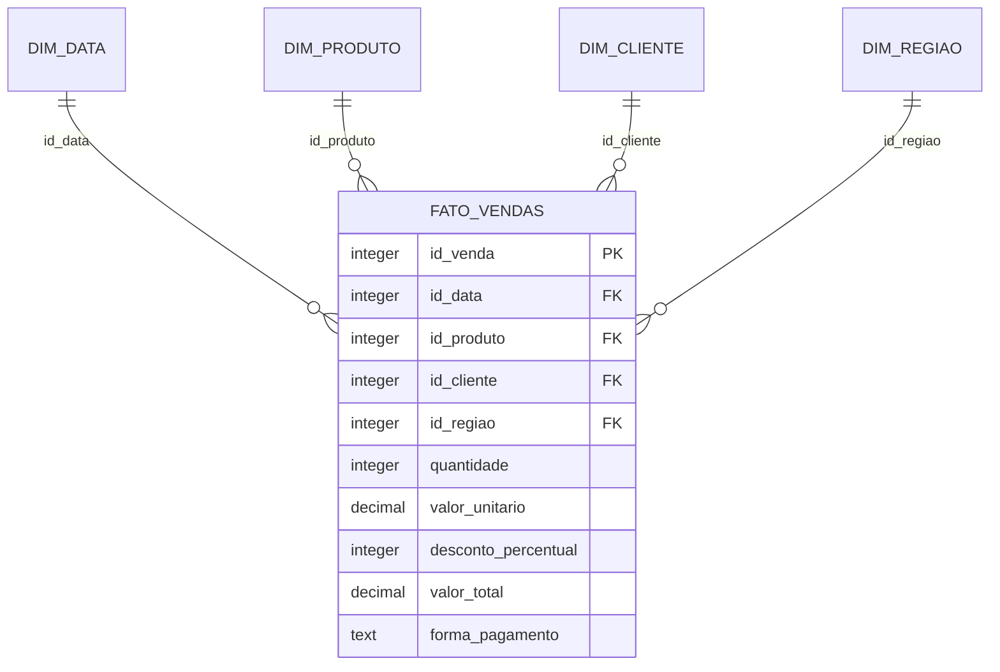

# Arquitetura e contrato de dados

## Decisões

O objetivo é tornar um caso de BI inspecionável: a mesma fonte alimenta as camadas, as métricas e as validações. O laboratório usa PostgreSQL para todas as camadas. Os notebooks preservam o raciocínio didático; os scripts fornecem uma trilha operacional repetível.

O Compose original permanece disponível. A stack `vendas-demo` possui volume, portas e banco de metadados próprios para evitar dependência do ambiente já utilizado na conversa.

## Grão e modelo dimensional

`id_venda` identifica uma venda. Neste conjunto sintético cada venda possui exatamente um produto e uma quantidade. O modelo não representa pedidos com múltiplas linhas; em uma fonte desse tipo seria necessário separar identificadores de pedido e de item, e reavaliar o grão da fato.

Dimensões utilizam chaves substitutas e restrições naturais únicas. Na carga CLI, dimensões existentes são preservadas; novos membros são inseridos. Isso não implementa SCD: alterações em atributos naturais podem criar novos membros e membros sem fatos podem permanecer.

## Camadas

| Camada | Papel | Transformação principal |
|---|---|---|
| CSV | Fonte determinística sintética | `random.seed(42)`, mil linhas |
| Bronze | Persistir dados tipados da fonte | Carga integral |
| Silver | Padronizar e enriquecer | TRIM, INITCAP, domínio e atributos de data |
| Gold | Servir análise dimensional | Dimensões e fato com FKs |
| Dataset virtual | Expor atributos de negócio | JOIN da fato com quatro dimensões |

Bronze não é uma cópia imutável de arquivos: contém colunas tipadas e é recarregada. O pipeline CLI exige reconciliação exata; se a transformação Silver eliminar registros, a transação falha em vez de aceitar perda silenciosa.

## Colunas do dataset analítico

| Grupo | Colunas |
|---|---|
| Identificação | `id_venda` |
| Tempo | `data`, `dia`, `mes`, `nome_mes`, `ano`, `trimestre`, `dia_semana` |
| Produto | `produto`, `categoria` |
| Cliente e região | `cliente`, `regiao` |
| Medidas | `quantidade`, `valor_unitario`, `desconto_percentual`, `valor_total` |
| Pagamento | `forma_pagamento` |

A dimensão Data contém datas presentes nas vendas, não um calendário contínuo completo. A série mensal deve usar `data` truncada por mês, preservando ano e mês, nunca apenas `nome_mes`.

## Semântica financeira

`valor_total = quantidade × valor_unitario × (1 − desconto_percentual / 100)`.

É receita do conjunto após desconto, sem modelagem de frete, impostos, devoluções, cancelamentos, custo ou margem. O validador utiliza `Decimal` e arredondamento por centavo. O gerador original utiliza `round`; a base fornecida foi conciliada com a validação decimal.

## Fronteiras de responsabilidade

- Pipeline: fonte, schemas, tabelas, transformações e reconciliação.
- Superset: conexão analítica, dataset virtual, métricas, gráficos e dashboard.
- MCP: ferramentas que o servidor efetivamente expõe; o schema define o que o cliente pode configurar.
- Codex: descoberta, chamadas e interpretação dos retornos, sem inventar parâmetros.
- Revisão manual: ajustes visuais que não são expostos pelo MCP observado.

O código do servidor MCP é mantido pelo Apache Superset. O diretório `config/` deste projeto contém apenas a configuração da demonstração e a imagem derivada.
